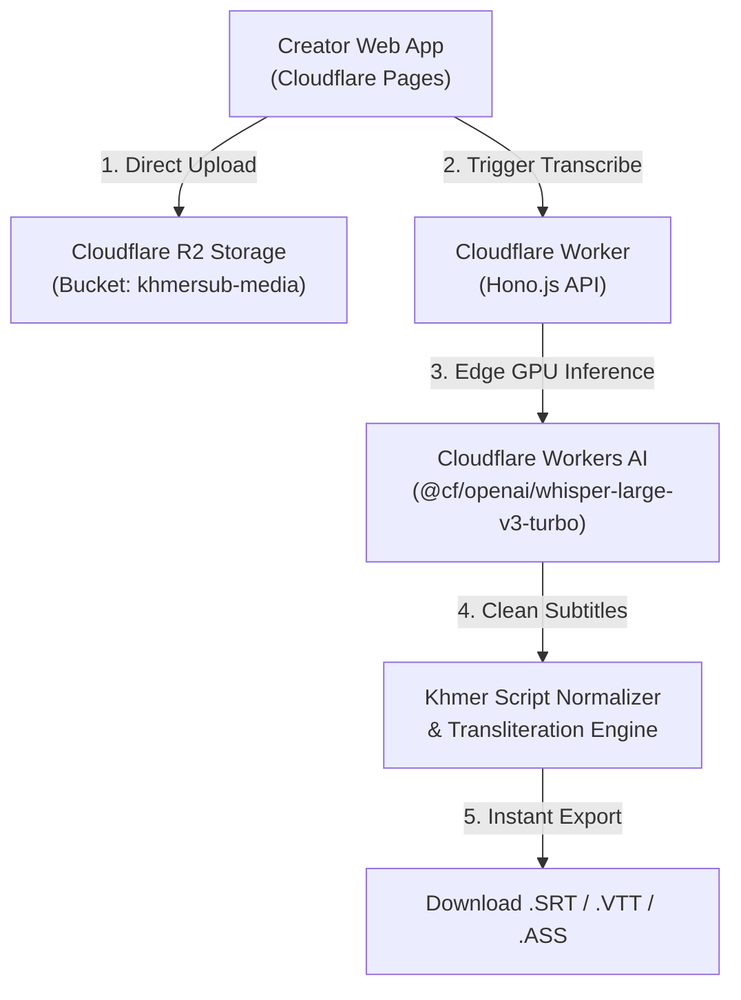

# KhmerSub AI - Cloudflare Edge Worker Architecture

Edge-native Serverless Backend for **KhmerSub AI** powered by:
- **Cloudflare Workers**: High-performance Edge API with Hono.js (< 15ms latency globally)
- **Cloudflare R2**: Zero-egress direct media storage for video & audio files
- **Cloudflare Workers AI**: Edge GPU inference running `@cf/openai/whisper-large-v3-turbo`
- **Bakong KHQR**: EMVCo Dynamic QR generator with CRC-16 on the Edge

---

## 🏗️ Architecture Overview



---

## 🚀 Quick Setup & Deployment

### 1. Install Dependencies
```bash
cd apps/cf-worker
npm install
```

### 2. Login to Cloudflare
```bash
npx wrangler login
```

### 3. Create Cloudflare R2 Bucket
```bash
npx wrangler r2 bucket create khmersub-media
npx wrangler r2 bucket create khmersub-media-dev
```

### 4. Run Locally (Local Development)
```bash
npm run dev
# The worker will run on http://localhost:8787
```

### 5. Deploy to Production
```bash
npm run deploy
```
Once deployed, your Worker will be live at:
`https://khmersub-cf-worker.<your-subdomain>.workers.dev`

---

## 📡 API Endpoints

| Method | Endpoint | Description |
| :--- | :--- | :--- |
| `GET` | `/health` | Edge location and Cloudflare bindings status |
| `POST` | `/api/v1/upload/direct` | Direct stream upload to Cloudflare R2 bucket |
| `GET` | `/api/v1/media/:key` | Stream video/audio from R2 with Range support |
| `GET` | `/api/v1/jobs/:id` | Poll transcription status & segments |
| `GET` | `/api/v1/jobs/:id/export/srt` | Download UTF-8 .SRT Subtitle |
| `GET` | `/api/v1/jobs/:id/export/vtt` | Download WebVTT Subtitle |
| `GET` | `/api/v1/jobs/:id/export/ass` | Download Styled .ASS Subtitle |
| `POST` | `/api/v1/billing/khqr` | Generate Bakong EMVCo Dynamic KHQR payment |

